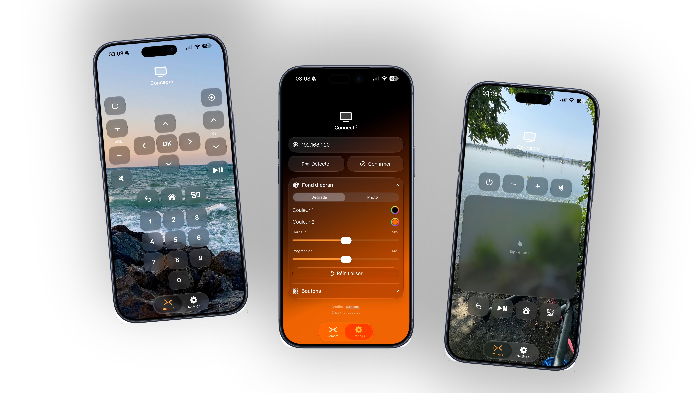
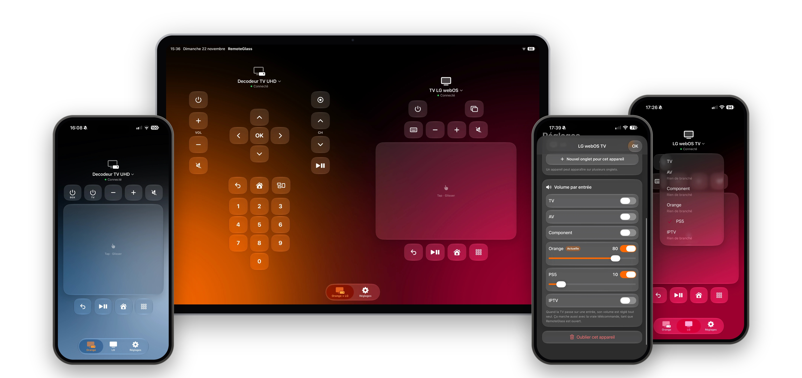

# RemoteGlass
Simple, local remote app for TV decoders and smart TVs, with a Liquid Glass design. Built (vibecoded) 100% in Swift.

## Supported devices
| Device | Notes |
| --- | --- |
| **Orange** TV decoders | Every Orange decoder (tested with the Livebox 5 UHD decoder) |
| **SFR** decoders | Décodeur TV 4K (STB7), LaBox, Box 8 decoder. SFR Connect TV goes through Google TV |
| **Freebox Player** | Révolution, Crystal, Delta and One. Pop, Ultra and Mini 4K go through Google TV |
| **Google TV / Android TV** | Every device using the Android TV Remote v2 protocol: Chromecast, Sony, TCL, Philips, Bbox, Free Player Pop… (not Amazon Fire TV) |
| **LG** webOS TVs | 2014 and later |
| **Samsung** Tizen TVs | 2016 and later |
| **Roku** | Roku TV, Express, Streaming Stick |
| **Hisense / Toshiba** VIDAA TVs | Depending on firmware. Hisense Google TV or Roku models use those protocols |

## Features
- 100% local, no login, no account, ads free
- Automatic network discovery for every supported device
- Up to 4 tabs, one per device, or several devices grouped in a single tab
- Split view on iPad and large screens: two remotes side by side
- Linked TV: control your TV's power and volume from a decoder's remote
- Source button to switch inputs (HDMI…) on TVs
- Per-input volume on LG TVs: the volume is set automatically when the TV switches input, even with the physical remote
- Keyboard input for Google TV, LG, Samsung and Roku
- Classic layout or compact layout with a trackpad
- Customizable background per tab: brand themes, dark and colorful multi-tone gradients, custom colors or a photo
- The app's accent color follows the background of the current tab; each device's settings use its brand color
- Squircle or circular buttons, adjustable Liquid Glass tint
- Haptic feedback
- In-app feedback form
- English and French

## Installation
Grab the latest .ipa in the Releases section and install it with any sideloading method (AltStore, SideStore, Sideloadly…). Also works completely fine inside LiveContainer.

OR

Join the TestFlight build.
https://testflight.apple.com/join/q1VHxx5y

## Usage
- Tap "Detect" (or "New Tab" / "Add a Device" in Settings)
- Pick your device in the list, or type its IP address
- Pair it if needed:
  - Google TV, Hisense: enter the code shown on the TV
  - LG, Samsung: accept the connection request on the TV
  - Freebox: enter the network remote code (TV: Settings › System › Freebox Player and Server information)
  - Orange, SFR, Roku: nothing to do

Updating from 1.x keeps your devices: every saved decoder and Google TV gets its own tab, no re-pairing needed.

## Known issues
The touch response shape has a higher corner radius than the actual remote buttons, that's an intrinsic Liquid Glass flaw from Apple for every non-circular shapes, Apple fixed that with iOS 27.

Two workarounds are available for iOS 26 users:
- Circular buttons option
- Disabling the HDR highlight and the button stretching in response to touch

On iOS 27, the app icon won't change despite the pop-up saying otherwise, until you respring/restart your iPhone.
That's an iOS 27 bug that will likely be fixed in an upcoming beta.

While using a white-based gradient, the buttons behind the white part become clearer than the others, I really don't know how to fix this while keeping a native Liquid Glass rendering.

While using a photo wallpaper for Google TV users, the buttons below the trackpad might go half behind the keyboard on some devices, currently trying to find a fix.
